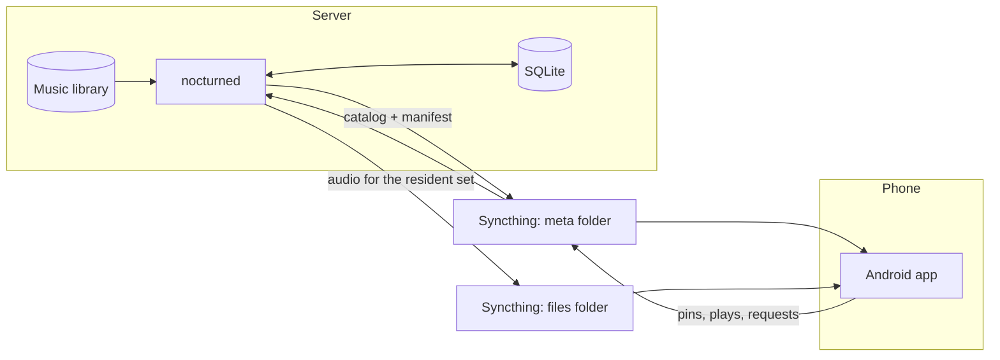

# nocturne

[](https://github.com/Lucasldab/nocturne/actions/workflows/test.yml)
[](https://github.com/Lucasldab/nocturne/releases)
[](LICENSE)

A self-hosted music system for a library too big to fit on a phone.

A Linux server keeps the full 100 GB+ library. A C daemon decides which part of
it belongs on the phone right now, based on what you pin, play and recently
added. An Android app browses the whole catalog and plays whatever is on the
device. Syncthing moves the files, with no streaming and no accounts.

## Why I built it

I wanted the convenience of a streaming app with music I own. Copying the whole
library wastes the phone's storage, and curating playlists by hand gets
abandoned. So the phone keeps a small set that rotates by itself, and any track
in the catalog is one pin away.

## How it works



Each cycle runs five steps, on a 15-minute timer and whenever the phone writes
something new:

1. **Scan** the library and update the database. An inotify watcher also keeps
   it current between cycles.
2. **Ingest** the pins, plays and other events the phone logged as JSONL.
3. **Resolve** which tracks should be on the phone, within the storage cap
   (12 GiB by default).
4. **Rotate** files in and out of the synced folder.
5. **Publish** the new catalog and manifest atomically.

The resolver fills the phone from configurable buckets: recent adds, top played,
recent plays, loved, exploration and weekly discovery. Pinned tracks and albums
get the highest priority, but they still count toward the cap. To see why a track
is on the phone, run `nocturned why <track-id>`.

When both devices are online, a pin reaches the phone in roughly 30–60 seconds,
mostly spent in the Syncthing round trip. If the phone is offline, the pin is
applied when it reconnects.

## Design decisions

- **No network access in the app or daemon.** The phone app doesn't request the
  `INTERNET` permission. `nocturned` only talks to Syncthing on loopback, and
  `make test` fails if that changes, using `ldd`, `nm`, source search, a runtime
  `strace` and `strings`. Anything that needs the network belongs in a separate
  program.
- **Plain files as the protocol.** The two devices only exchange JSON and JSONL
  files, so there is no server API to run or secure, and the phone works offline.
  The format is documented in [`docs/jsonl-spec.md`](docs/jsonl-spec.md).
- **One writer.** A lock file gives one `nocturned` process write access to the
  database at a time, and the systemd units hand the lock over between the
  watcher and each cycle.
- **Sync races are documented.** Syncthing can deliver files in the middle of a
  cycle. [`RACES.md`](RACES.md) records the races found in that pipeline.
- **Smaller files on the phone (optional).** Transcode mode keeps the FLAC on the
  server and sends the phone an Opus or AAC copy, optionally levelled per track.
  At 128 kbps Opus, a [13.2 MB test FLAC](docs/transcode.md) became 1.7 MB.

## Features

**Phone app** (Kotlin, Jetpack Compose, Media3)
- Browse and search the full catalog, including music not on the device
- Pin albums or tracks to bring them onto the phone, or unpin them with undo
- Queue with reorder, swipe to remove and play next
- Request a download from the app, or by sharing a Spotify link to it

**Daemon** (C, SQLite, TagLib, libcurl for loopback only)
- Automatic rotation, driven by phone listening stats and the buckets above
- Weekly discovery picks and health checks (`doctor`, `diskcheck`)
- Download requests handed to an external command you configure (none is included)

## Status

Pre-1.0 and built for one user: me. I run the server on Linux and the app on
GrapheneOS. Other setups should work, but only this one gets regular use. Signed
APKs are on [Releases](https://github.com/Lucasldab/nocturne/releases), and they
install and update through [Obtainium](https://github.com/ImranR98/Obtainium).

## Getting started

You need `make`, a C compiler, `pkg-config`, `xxd`, TagLib, SQLite, Jansson,
libcurl and Syncthing. `ffmpeg` is needed for transcode mode, and `strace` for
the full test suite.

```sh
make nocturned      # builds build/nocturned
make test           # runs unit and integration tests, plus the network audit
```

To build the phone app (JDK 21 and the Android SDK; the app needs Android 8.0+):

```sh
cd phone
./gradlew :app:assembleDebug
adb install -r app/build/outputs/apk/debug/*.apk
```

Follow these in order for a full setup:

1. [Server install](docs/install.md): configuration, library migration, Syncthing and systemd units
2. [Phone setup](docs/phone-setup.md): pairing and the two sync folders
3. [Troubleshooting](docs/troubleshooting.md): recovery by symptom

## Testing

| Suite | Command | Runs in CI |
|-------|---------|------------|
| Daemon unit and integration tests, network audit | `make test` | No, run locally |
| Phone unit tests | `cd phone && ./gradlew :app:testDebugUnitTest` | Yes, on every push to `main` and every PR |

A release tag builds a signed APK only if the phone tests pass, because Obtainium
can install anything that reaches Releases.

## Repository layout

| Path | Contents |
|------|----------|
| `src/nocturned/` | The daemon |
| `src/tagcheck/` | `nocturne-tagcheck`, a library tag checker |
| `phone/` | The Android app |
| `schema/` | SQL schema and JSONL definitions |
| `config/` | Example config, systemd units and helper scripts |
| `tests/` | C and shell tests, plus fixtures |
| `docs/` | Setup, file formats and troubleshooting |
| `vendor/` | Vendored dependency (`toml-c`) |

## License

[MIT](LICENSE)
